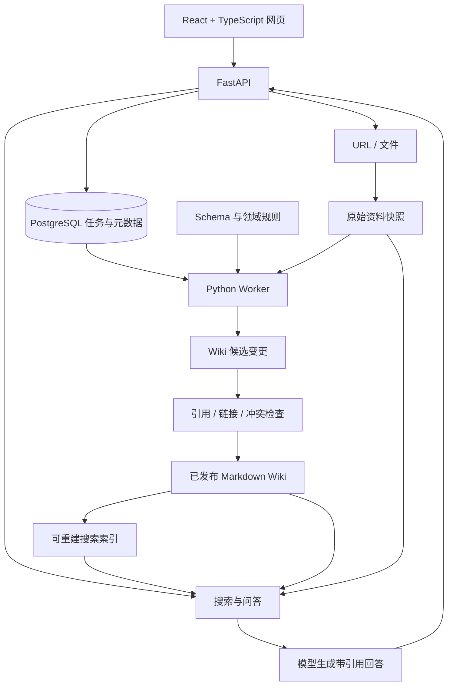

# 舰 C LLM Wiki 知识库

面向 Kantai Collection（舰队 Collection / 舰 C）的知识整理、浏览、检索与问答网页服务。

采用 **Python + LLM Wiki + TypeScript** 架构：保留原始资料，由 LLM 持续整理和更新相互关联的 Wiki 页面，用户通过网页阅读知识、搜索资料并获得带来源引用的回答。

> 已实现首批知识数据源定期抓取后端：PostgreSQL 元数据、原始 HTML 快照、月度调度、独立 Worker 与管理 API。LLM 编译、检索问答和前端仍处于设计阶段。本文其余架构内容为目标设计。

## 设计方向

参考 [nashsu/llm_wiki](https://github.com/nashsu/llm_wiki) 的知识维护流程，使用 Python 实现服务端，使用 TypeScript 实现网页端。该仓库是参考实现，具体代码复用范围需要进一步评估。

核心流程：

```text
原始资料 → LLM 分析 → 生成关联页面变更 → 校验 → 发布 Wiki
                                                   ↓
                                      网页浏览、搜索与引用问答
```

LLM 在资料导入时完成知识整理，并在后续更新中维护页面。查询主要读取已发布的 Wiki；需要核对细节时回溯原始资料。

第一版采用模块化单体，API 与后台 Worker 共用领域逻辑、分别运行。同一个知识库的编译和发布任务串行处理。

## 技术栈

| 部分 | 选择 | 用途 |
| --- | --- | --- |
| 前端 | React + TypeScript + Vite | Wiki 阅读、搜索、问答、资料与任务管理 |
| API | Python + FastAPI + Pydantic | 接口、输入校验、问答编排与模型配置 |
| 后台任务 | 独立 Python Worker | 资料解析、LLM 编译、校验与发布 |
| 数据库 | PostgreSQL | 来源元数据、任务、依赖、版本与会话 |
| 数据访问 | SQLAlchemy + Alembic | 数据访问与数据库迁移 |
| 知识正文 | Markdown + YAML frontmatter | 页面内容、实体标识、别名、引用与关联 |
| 知识版本 | Git | 记录 Wiki 变更、发布与回滚 |
| 实时交互 | SSE | 流式回答与任务进度 |
| 部署 | Docker Compose | 单机部署与持久化管理 |

第一版不单独部署向量数据库，也不引入多 Agent、MCP 或额外的消息队列服务。后台任务通过 PostgreSQL 持久化，Worker 领取任务并记录进度、失败与重试状态。

## 系统架构



### 三层知识结构

- **Raw**：导入资料的不可变快照，保留来源、抓取时间、来源修订时间和内容哈希；来源更新时创建新快照。
- **Wiki**：LLM 生成和维护的知识页面，按实体与主题组织，通过链接关联，包含明确的来源引用。
- **Schema**：定义知识范围、页面类型、模板、命名、引用、冲突处理和更新规则；每次编译记录所用规则版本。

Markdown 保存知识正文，PostgreSQL 管理运行状态和派生元数据，搜索索引可从发布版本重建。发布记录关联 Wiki Git 提交和索引版本，查询固定读取同一个发布版本。

## 舰 C 领域设计

### 页面类型

| 类型 | 主要内容 |
| --- | --- |
| 舰娘 | 属性、改造形态、改造条件、相关装备与任务 |
| 装备 | 属性、分类、适用条件、改修与获取方式 |
| 机制 | 制空、索敌、伤害、支援等机制说明 |
| 任务 | 编号、完成条件、前置关系与奖励 |
| 海域 | 路线条件、敌编成、攻略与掉落来源 |
| 活动 | 活动时间、阶段、难度、规则与历史攻略 |
| 来源摘要 | 原始资料摘要、出处与相关页面 |

使用稳定 ID 关联页面，维护日文名、中文名、简称与昵称。改造形态应明确区分，并关联所属舰娘。保留数值表、单位和适用条件，避免摘要丢失关键限制。

### 时效与来源

- 区分抓取时间、来源修订时间和结论适用时间。
- 明确标记常驻内容、历史活动、难度、阶段以及尚未证实的推测。
- 新旧资料冲突时保留各自的证据与适用条件，生成待处理项。
- 重要结论引用原始资料的具体段落或表格位置，不能只关联整份文档。
- 掉落统计保留时间范围、样本量、统计条件与出处；不把估计值描述成固定概率。

## 核心工作流

### 1. 导入与编译（Ingest）

1. 接收 URL 或文件，保存原始快照与来源元数据。
2. 根据内容哈希识别重复或未变更资料。
3. 解析为适合模型读取的内容，保留标题层级、表格及来源定位信息。
4. LLM 提取实体、知识点、适用条件与冲突，定位已有相关页面。
5. 在独立工作区生成来源摘要、新页面及现有页面的候选变更。
6. 检查 frontmatter、内部链接、引用目标和页面结构；数值等关键内容核对原文，语义冲突进入待处理列表。
7. 检查通过后发布完整版本，更新依赖关系和搜索索引，记录变更日志。

编译任务包含持久化状态、进度、有限重试与幂等标识。失败任务不影响当前发布版本；编译中的页面不会直接出现在阅读和问答结果中。

### 2. 搜索与问答（Query）

```text
问题 → 别名归一化 → 标题与全文检索 → 关联链接扩展
     → 读取已发布页面 → 必要时核对原文 → 生成带引用回答
```

第一版使用别名匹配、支持中日文的分词与全文检索，以及 Wiki 链接扩展。任务编号、海域编号、装备名等需要保留精确匹配能力；中文和日文检索需要单独实现并验证分词及领域词典，不直接套用英文检索配置。

回答提供 Wiki 页面与原始证据引用。证据不足时明确说明，来源冲突时展示分歧。问答默认不修改 Wiki，有价值的回答可保存为候选内容，经来源检查后进入编译流程。

### 3. 知识检查（Lint）

检查失效链接、孤立页面、缺失来源、未处理冲突与可能过期的内容。程序执行可确定的结构检查，LLM 辅助发现语义问题，结果进入待处理列表。

## 存储与发布约定

- 原始快照不可由 LLM 覆盖；保留原文件与解析产物的对应关系。
- 每个 Wiki 页面包含稳定 ID、类型、标题、别名、来源、关联实体和适用条件等元数据。
- 维护“来源快照 → Wiki 页面”的依赖关系，便于来源更新后定位受影响页面。
- 删除来源时重新评估关联页面；仅移除引用不足以证明原结论仍然成立。
- 后台在独立工作区生成变更，完成校验与索引构建后切换发布版本。
- 回滚同时恢复对应 Wiki 版本及索引；数据库状态与发布关系需要同步恢复。
- 原始资料属于待处理数据，不作为系统指令执行；模型只通过受限接口读取资料和提出页面变更。
- API 密钥仅在服务端保存，不写入 Wiki、Git 或浏览器配置。

## 规划目录

```text
frontend/                    # React + TypeScript
backend/
  app/
    api/                     # 阅读、搜索、问答、资料与任务接口
    domain/                  # 领域模型与页面规则
    ingestion/               # 采集、解析、来源管理
    compiler/                # 分析、页面变更与校验
    retrieval/               # 别名、全文检索与链接扩展
    answering/               # 上下文、生成与引用
    publishing/              # 发布版本、索引与回滚
    providers/               # LLM 接口适配
    db/                      # SQLAlchemy 模型与数据访问
    worker/                  # 任务领取与执行
  migrations/                # Alembic
knowledge/
  schema/                    # purpose、模板、引用和更新规则
  raw/                       # 原始资料快照与解析产物
  wiki/                      # 已发布知识的 Markdown 内容
    ships/
    equipment/
    mechanics/
    quests/
    maps/
    events/
    sources/
  staging/                   # 编译工作区与候选变更
  releases/                  # 发布版本与索引产物
  history/                   # Wiki Git 历史
evals/                      # 检索、编译与引用质量评测
infra/                       # 容器与部署配置
compose.yaml
.env.example
```

`knowledge/` 为运行时持久化目录；知识历史与应用代码版本独立管理。以上为规划目录，具体布局随实现调整。

## 第一版范围

1. 提供文件与 URL 导入，展示持久化编译任务的进度和失败信息。
2. 实现来源摘要、实体页面、关联链接和来源更新后的增量编译。
3. 提供 Wiki 导航、页面阅读、来源查看与基础全文搜索。
4. 提供流式问答，答案包含可跳转的页面和原始证据引用。
5. 提供编译变更查看、完整版本发布和回滚。
6. 提供基础知识检查与冲突待处理列表。

先以一个资料来源和少量舰娘、装备、机制资料完成闭环，再扩充覆盖范围。首版按单维护者部署设计；对外开放管理功能前补充认证与权限控制。

## 验证与后续扩展

使用真实舰 C 问题验证别名、编号、中文与日文查询、跨页面问题、历史版本和来源冲突。关注检索命中、引用正确性、关键信息保留、增量更新影响范围及失败恢复。

若评测发现语义表达差异导致明显漏检，再引入 PostgreSQL 的 pgvector，与关键词检索组合；当前无需单独部署向量数据库。

后续按实际需要增加确定性计算工具、更多采集源、多用户权限，以及 MCP 等对外接口。

## 启动说明

### Python 开发环境（已配置）

使用 uv 管理 Python 3.12、项目虚拟环境及依赖。先安装 [uv](https://docs.astral.sh/uv/getting-started/installation/)，在仓库根目录执行：

```sh
uv sync --locked
```

uv 会按 `.python-version` 选择 Python 3.12，缺少时自动下载，并在 `.venv/` 中安装 `uv.lock` 锁定的运行依赖和开发工具。无需手动激活环境，后续命令使用 `uv run` 执行。`pyproject.toml` 管理直接依赖，`uv.lock` 应提交到版本控制；`.venv/` 不提交。

当前运行依赖包括 FastAPI、Uvicorn、Pydantic、Pydantic Settings、SQLAlchemy、Alembic、PostgreSQL 驱动 Psycopg、HTTPX 和 Markdown frontmatter 解析器；开发依赖为 Ruff、pytest、pytest-cov 和 coverage。数据库服务可使用下述 Compose 配置。

HTTPX 已启用 SOCKS 支持（`httpx[socks]`），可使用运行环境中的 HTTP / HTTPS / SOCKS5 代理。更新后执行 `uv sync --locked`，避免因缺少 `socksio` 导致客户端初始化失败。单元测试使用隔离的 HTTP 客户端或采集器替身，不读取本机代理设置。

```sh
# 添加运行依赖或开发工具，并同步更新锁文件
uv add <package>
uv add --dev <package>

# 后续新增 Python 代码时，仅对本次修改的文件执行
uv run ruff format path/to/file.py
uv run ruff check path/to/file.py
```

### 数据源抓取（已实现）

预置数据源：

- `wikiwiki-kancolle`：https://wikiwiki.jp/kancolle/
- `kcwiki-zh`：https://zh.kcwiki.cn/wiki/舰娘百科

首次启动后立即安排抓取，以后默认每 **1 个自然月**安排一次（UTC；月末取目标月最后一天），停机错过多次时仅补一次。可按来源调整 `interval_months`，修改周期会从当前时间重新计算下次时间。Worker 每 30 秒检查到期任务。

默认从入口页广度优先发现同站 Wiki 链接，最大深度 2、最多尝试 1000 页、请求至少间隔 3 秒。这是有界采集，不保证覆盖整个站点；任务 `truncated` 表示达到页数上限。`max_depth=0` 仅抓取入口页。过滤带查询参数、命名空间及部分评论/管理页的链接；当前尚未实现 Wiki 专用正文抽取或完整页面清单同步。

每次抓取先读取 robots.txt（404 视作无限制，其他读取错误或重定向停止任务），遵守禁止路径和 Crawl-delay。仅允许两个预置域名及 `/kancolle/`、`/wiki/` 路径，重定向也受相同范围限制。单页上限 10 MiB、请求超时 30 秒，不下载图片或附件。请在 `.env` 的 User-Agent 中填写联系方式。

原始响应字节按 SHA-256 与该页面上一次内容比较，变化时新增 `original.html` 和 `metadata.json`，记录原始/最终 URL、抓取时间、HTTP Last-Modified（来源提供时）和内容类型。HTML 中动态导航等变化也会产生快照；尚无语义去重。未变化只更新检查时间。快照路径相对于 `MINNE_RAW_DIR`，数据库通过页面关联来源 URL。未实现网页删除检测。

任务和每页结果持久化，页面失败后继续其他页面，整体最多尝试 3 次，重试等待 5/10 分钟。重试重新遍历入口，已保存且未变化的内容不会新增快照；进度计数表示当前一次尝试。原始文件先写入、数据库后提交，崩溃可能留下无数据库引用的文件，备份时保留数据库与完整 raw 目录。

Worker 使用 PostgreSQL 会话 advisory lock 保证单实例；中断后下次启动恢复 running 任务。来源禁用只停止自动调度，已排队任务与手动触发仍可执行。同一来源最多一个 pending/running 任务。

```sh
uv sync --locked
cp .env.example .env
# 修改 .env 中联系方式；自定义数据库密码时同时修改连接串
# Compose 当前只提供 PostgreSQL，API / Worker 在本机运行
docker compose up -d db
uv run alembic upgrade head
# 两个终端分别运行
uv run uvicorn backend.app.main:app --host 127.0.0.1 --port 8000
uv run python -m backend.app.worker.main
```

API 文档：`http://127.0.0.1:8000/docs`。管理 API 尚无认证，仅绑定本机使用。

| 接口 | 用途 |
| --- | --- |
| `GET /sources` | 查看预置来源和下次抓取时间 |
| `PATCH /sources/{id}` | 修改 enabled、interval_months、max_pages、max_depth、delay_seconds |
| `POST /sources/{id}/crawl` | 手动触发；已有活动任务时返回该任务 |
| `GET /jobs` / `GET /jobs/{id}` | 查看任务状态、当前尝试进度和错误 |
| `GET /snapshots` | 查看快照元数据；原文件从持久化目录读取 |

例如将日文 Wiki 调整为每两个月抓取、最多 2000 页：

```sh
curl -X PATCH http://127.0.0.1:8000/sources/wikiwiki-kancolle \
  -H 'Content-Type: application/json' \
  -d '{"interval_months":2,"max_pages":2000}'
curl -X POST http://127.0.0.1:8000/sources/wikiwiki-kancolle/crawl
```

### 手动验证

VS Code 工作区已配置使用 `.venv/bin/python` 和 pytest，关闭保存时自动发现测试。pytest 与 pytest-cov 已加入开发依赖，执行 `uv sync --locked` 即可安装。现有 unittest 风格用例由 pytest 运行。若编辑器仍使用旧配置，运行 `Developer: Reload Window`，并通过 `Python: Select Interpreter` 选择项目 `.venv/bin/python`，再手动刷新测试面板。

测试未执行，需用户手动执行；覆盖率待用户验证。核心统计范围明确为 `backend/app/ingestion/` 与 `backend/app/worker/` 全部模块（含 HTTP 采集、存储、范围规则、调度、执行和失败处理），最低门槛超过 60%，目标超过 80%。测试使用内存 SQLite、HTTP 替身和临时目录，不依赖真实站点或 PostgreSQL。PostgreSQL 锁、迁移和服务联调仍需实际环境验证。

```sh
uv run python -m pytest
# 使用 pyproject.toml 中列出的全部核心模块范围统计覆盖率
uv run python -m pytest --cov --cov-report=term-missing --cov-report=html
```

真实站点的完整采集尚未执行。启动后先将 `max_pages` 调至较小值进行人工检查，确认 robots 规则、页面覆盖及快照内容，再调整抓取范围。LLM 编译、来源依赖、前端与完整应用容器部署尚待实现。
